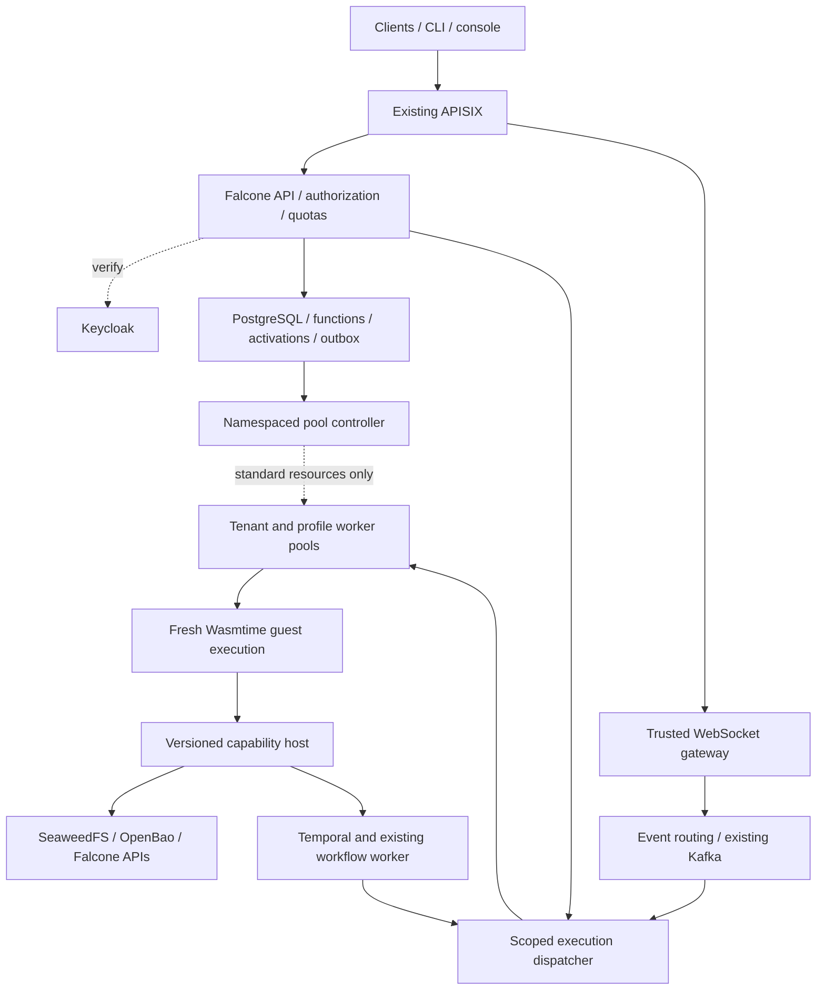

# falcone-serverless: Option A implementation specification

Updated 21 October 2026. **Architecture direction accepted by the user; implementation, corporate-cluster feasibility and security qualification remain unverified.** This revision supersedes the initial native-container execution design. The original survey is retained as comparative evidence.

## Accepted direction and scope

Build a Falcone-owned **WebAssembly/WASI execution layer inside ordinary restricted Kubernetes/OpenShift pods**, using Wasmtime as the sandbox engine. Keep Keycloak, SeaweedFS, Temporal, APISIX, Kafka, PostgreSQL and OpenBao. Falcone owns APIs, quotas, execution policy, integrations, routing and lifecycle.

The product supports untrusted code through explicitly qualified language and package profiles. It does **not** accept arbitrary tenant Linux containers, native executables, native install scripts or unrestricted operating-system access. Existing Functions APIs, URLs and data contracts remain the compatibility target; raw Knative APIs and URLs are excluded.

**Compatibility is a measured gate.** Unsupported legacy dependencies block those workloads from migration. Selecting Option A is not proof that every existing function can run under Wasm. Neither silent native fallback nor weakening sandbox boundaries is an acceptable compatibility mechanism.

### Confirmed requirements

| Topic | Accepted requirement |
| --- | --- |
| Motivation | Corporate OpenShift restrictions make operators and special permissions difficult; prioritize namespace-only deployment, performance, Falcone integration and extensibility |
| Execution location | Option A inside restricted pods; no administrator-provided sandbox runtime |
| Deployment permissions | No required operator, CRD, ClusterRole, custom RuntimeClass, elevated SCC or host access; use existing approved namespaces and pregranted namespaced RBAC |
| Tenant trust | Arbitrary untrusted code within qualified Wasm profiles; no arbitrary native execution |
| Scale | Approximately 20 tenants and 10,000 deployed function definitions |
| Messaging | Approximately 100,000 aggregate WebSocket/event messages per second; mostly messaging, not 100,000 function invocations/second |
| Execution quota | Initial configurable estimate of 20 simultaneous executions per tenant; roughly 400 total if all 20 tenants use their quota |
| Analysis | Extended asynchronous jobs, configurable duration limits, progress, cancellation and application checkpoint/resume |
| Kubernetes | Latest two qualified stable minor lines, currently 1.37 and 1.36 in the research snapshot; patch-pinned releases |
| OpenShift | 4.20 / Kubernetes 1.33 family; exact OpenShift patch bundling the user's Kubernetes 1.33.12 must be confirmed from cluster metadata |
| SeaweedFS | Latest two qualified stable releases, currently 4.48 and 4.47 in the research snapshot; preserve the existing notification configuration when supplied |
| Transport | Existing WebSockets are mandatory; actual deployed Model Context Protocol behavior must be inventoried, not inferred from the ambiguous term “MCP” |
| Quotas | Definitions, accounting and charging policies are owned directly by Falcone |

20 execution slots per tenant are a quota assumption, not enough information to size compute. Required concurrency is approximately invocation rate times mean running duration, plus headroom. Function-trigger fraction, fan-out and duration distributions are still needed. WebSocket sessions and message forwarding do not inherently occupy guest execution slots.

### Evidence and boundaries

The prior targeted repository review used commit `bde62dd1e2e91f957b1dc6b8212dfbbaee977a7f`; no new live deployment inspection is claimed.

- Falcone's existing Node.js services, identity/plan policies and integration adapters remain the product facade. [S1]
- The source-based `main(params)` runtime and response envelope need explicit Wasm compatibility tests. [S2]
- The existing Temporal `functions.invoke` Activity's workspace binding and failure mapping remain mandatory. [S3]
- Existing managed-Knative documentation distinguishes source implementation from deployed acceptance. This replacement retains that evidence discipline. [S4–S5, S9]

Original work can follow Falcone's existing license policy, while exact pinned engine/toolchain/package licenses remain part of release review.

## 1. Survey and comparative analysis

### Knative components and capabilities

| Component | Responsibility |
| --- | --- |
| Serving resources | Service coordinates Configuration, immutable Revision and Route resources; supports revision rollouts and weighted traffic. |
| Serving controller and webhooks | Reconcile resources and validate/default configuration. |
| Autoscaler | Adjusts replicas from demand; Knative Pod Autoscaler supports request/concurrency-driven scaling and scale-to-zero. HPA support is a different scaling mode. |
| Activator | Buffers requests during activation and some burst conditions, requests scale-up, then forwards to ready capacity. |
| Queue-proxy | Per-pod request accounting and concurrency enforcement. |
| Networking adapter | Kourier, Contour or Istio implements Knative's ingress abstraction. Kourier is a lightweight Envoy-based adapter, not a required component of every Knative installation. |
| Eventing | Sources, Brokers, Triggers, Channels and Subscriptions connect CloudEvents producers/consumers; broker/channel implementations determine persistence and delivery properties. |
| Functions tooling | Source templates, local development and build/deploy tooling; distinct from the core Serving execution machinery. |

Serving architecture and networking are documented upstream. [S6–S7] Event retry and dead-letter behavior are separately configured; Eventing does not imply exactly-once function side effects. [S8]

### Falcone-specific pain points

**Verified integration concerns:** installation ownership spans cluster-scoped resources; coordinated chart/application acceptance is unfinished in the reviewed proposal; OpenShift admission requires explicit compatibility work; runtime outages must preserve tenant-safe errors and durable cleanup. These are recorded in Falcone's design/status documents. [S4–S5, S9]

**Architectural costs to measure:** overlapping control planes, additional proxies, cold-start delays, and the effort to map Knative resources to Falcone roles/quotas. These are plausible costs, not measured defects in the current deployment. A custom implementation will inherit activation, routing, fairness, draining and lifecycle responsibilities.

Do not assume Eventing is installed: the reviewed managed-Serving design explicitly excludes it. Retain the existing Kafka/scheduling integrations unless deployment discovery proves an additional Eventing dependency. [S5]

### Alternatives

Four established open-source alternatives are **Fission, Apache OpenWhisk, Nuclio and Fn Project**. They are mature architectural reference points, but not equally suitable or equally validated for Falcone's cluster matrix. OpenFaaS is included separately because its current distribution/license boundaries matter. Kubeless is a historical reference, not an actively maintained shortlist candidate.

| Platform | Features and scalability | Extension mechanisms | Fit for Keycloak / SeaweedFS / Temporal / tenancy | Strength and weakness versus Knative |
| --- | --- | --- | --- | --- |
| **Knative — baseline** | Container services; revisions; weighted routes; request/concurrency scaling; activation from zero; separate eventing ecosystem | Networking adapters, event sources/brokers, container contract | Falcone must supply business authorization, S3 credentials/events and Temporal Activities; Kubernetes boundaries need additional tenant controls | Broad Serving behavior and ecosystem; substantial platform machinery |
| **Fission — Apache-2.0** | Source functions, containers, HTTP/timer/message triggers; warm environment pools or per-function Deployments/HPA | Environment images, builders, CRDs and trigger adapters | Keycloak through Falcone ingress; S3 SDK/bindings and storage-event bridge; Temporal via invocation adapter; multi-namespace facilities still need Falcone authorization | Attractive source workflow and warm-pool design; pool cost/isolation and executor-specific behavior require validation |
| **Apache OpenWhisk — Apache-2.0** | Actions, activations, packages, feeds, triggers/rules and sequences; controllers/invokers schedule work and reuse containers; explicit limits | Language runtimes, packages/feeds, implementation SPIs | Auth/namespace translation at Falcone facade; S3 through actions/feed adapter; Temporal invokes actions and remains workflow owner; namespace quotas are useful but not Falcone roles | Rich FaaS accounting/events; heavier services and a different activation/runtime model |
| **Nuclio — Apache-2.0 core** | HTTP and streaming/broker triggers, language runtimes, function processors, concurrent workers and Kubernetes replica scaling | Runtime and trigger implementations, function config and custom images | Keycloak at Falcone boundary; S3 SDK/custom adapter; Temporal invocation bridge; projects/namespaces need security hardening | Useful event/data-processing architecture; edition/deployment-specific auth and scale-to-zero must be verified |
| **Fn Project — Apache-2.0 core** | Container functions, applications/triggers, CLI and language FDKs; execution agents and load-balancing agent support distributed capacity | FDKs, containers and Go extension hooks | External IAM facade; S3 client/config integration; Temporal adapter; application grouping alone is not tenant isolation | Simple container-oriented model; more Kubernetes lifecycle/routing work and release/support qualification than Knative |
| **OpenFaaS — current edition restrictions** | Templates, image functions, sync/async invocation; scaling, tenancy and production features depend on edition | Templates, watchdog, provider and connector interfaces | Falcone adapters still required; multi-namespace and advanced scaling availability must be checked by edition | Strong developer ergonomics; current CE is restricted, with production/commercial and scale-to-zero boundaries |
| **Kubeless — archived** | Historically Kubernetes-native functions, runtimes and triggers | CRDs/runtimes | Would require maintaining the platform and all Falcone adapters | Useful historical simplicity; reject as a new production foundation |

Fission's executor types and architecture are documented in [S10–S11]. OpenWhisk's action/namespace model and service architecture are documented in [S12–S14]. Nuclio's processor and trigger model is documented in [S15–S16]. Fn's runtime and agent mechanisms are documented in [S17–S18].

**Licensing correction:** current OpenFaaS documentation describes CE restrictions, including a commercial trial limit; advanced scaling/scale-to-zero is edition-dependent. Do not classify its complete current Kubernetes distribution as an unrestricted OSS dependency. Review individual pinned repositories, binaries and licenses before reuse. [S19–S20] Kubeless explicitly states that it is no longer actively maintained. [S21]

**Selection:** retain Knative as the migration reference; use Fission as the closest benchmark for source deployment and warm capacity, OpenWhisk for activation accounting, Nuclio for event adapters, and Fn for runtime portability. None is a drop-in combination of Falcone's IAM, object-store and Temporal contracts.

## 2. Functional requirements checklist
All 84 statements apply to the accepted Option A design. Milestones do not establish production qualification. Unsupported existing workloads block their migration; API compatibility does not imply arbitrary Linux-runtime compatibility.

### API. API and developer experience

- [ ] **FR-API-01:** The system must preserve inventoried Falcone Functions routes, API versions, request/response schemas, error codes, pagination and idempotency behavior through a compatibility adapter.
- [ ] **FR-API-02:** The system must provide authenticated REST and CLI operations to create, inspect, update, invoke, roll back and delete functions and inspect activations.
- [ ] **FR-API-03:** The system must provide JavaScript, Python and Go starters only for qualified Wasm/WASI profiles, with pinned supported dependencies and a local invocation command; show unsupported capabilities before deployment.
- [ ] **FR-API-04:** The system must accept a versioned declarative function manifest, validate it before deployment and return field-specific errors without partial mutations.
- [ ] **FR-API-05:** The system must expose runtime readiness and deployment progress in the existing console with role-appropriate detail and accessible failure states.
- [ ] **FR-API-06:** The system must publish machine-readable OpenAPI schemas and run generated-client contract tests against every supported API version.

### RUN. Runtime and execution

- [ ] **FR-RUN-01:** The system must execute validated WebAssembly modules/components using a pinned Wasmtime worker and versioned Falcone host interfaces; reject arbitrary native tenant binaries and OCI container execution.
- [ ] **FR-RUN-02:** The system must preserve main(params), result/status/log envelopes and scoped invocation verification for qualified legacy functions; detect unsupported libraries or OS behavior and block migration rather than silently altering semantics.
- [ ] **FR-RUN-03:** The system must enforce guest memory, host-buffer, compiler, CPU, payload, execution-time and concurrency budgets; report the specific exceeded limit.
- [ ] **FR-RUN-04:** The system must provide worker readiness/startup probes, bounded draining, guest interruption and host-call cancellation; reject new executions on draining workers.
- [ ] **FR-RUN-05:** The system must create fresh guest state for each invocation; reuse only validated compiled code, never another invocation’s memory, file handles, credentials or temporary files.
- [ ] **FR-RUN-06:** The system must publish a pinned engine/WASI/language/package support matrix and EOL policy; block unsupported combinations before deployment without silently changing revisions.

### DEP. Build, revisions and deployment

- [ ] **FR-DEP-01:** The system must build supported source into Wasm with approved toolchains and dependency catalogues, or accept validated raw Wasm artifacts; never execute tenant-provided native install hooks, Dockerfiles or build scripts in an unsandboxed host.
- [ ] **FR-DEP-02:** The system must generate SBOM/provenance for function artifacts and trusted worker images, verify signatures, validate Wasm imports/features and pin every runtime/artifact dependency by digest.
- [ ] **FR-DEP-03:** The system must create an immutable revision for code, engine/profile, host-interface or effective configuration changes and retain all artifact references.
- [ ] **FR-DEP-04:** The system must deploy a revision only after readiness succeeds; support weighted canary traffic and atomic rollback to a retained revision.
- [ ] **FR-DEP-05:** The system must reconcile tenant worker pools and routing generations after restarts; represent deployed functions as metadata/artifacts without allocating one pod or Service per function.
- [ ] **FR-DEP-06:** The system must garbage-collect obsolete images, revisions and build artifacts only after checking active routes, in-flight invocations, rollback retention and workflow pins.

### INV. Invocation, routing and autoscaling

- [ ] **FR-INV-01:** The system must route synchronous invocations to authorized tenant-scoped Wasm workers with a pinned immutable function revision and a configured end-to-end deadline.
- [ ] **FR-INV-02:** The system must accept asynchronous invocations only after durable persistence, return an activation ID, and expose terminal status and result retrieval.
- [ ] **FR-INV-03:** The system must enforce per-pod hard concurrency and tenant-wide admission limits across multiple router replicas; bound queue length and waiting time.
- [ ] **FR-INV-04:** The system must scale tenant/profile worker pools between configured minimum and maximum replicas from execution demand and admitted backlog; support idle scale-to-zero without tying replica count to deployed function count or raw message rate.
- [ ] **FR-INV-05:** The system must prevent scale-down from discarding admitted work, account for long-running jobs, use stabilization and metric freshness, and maintain exactly one scaling owner per worker pool.
- [ ] **FR-INV-06:** The system must preserve existing WebSocket URLs, authentication, ordering rules, backpressure, reconnect and draining semantics at a trusted gateway; separate connection/message capacity from guest execution slots.

### EVT. Events and triggers

- [ ] **FR-EVT-01:** The system must normalize Kafka, storage, webhook and scheduled events into versioned CloudEvents envelopes containing trusted tenant/workspace context.
- [ ] **FR-EVT-02:** The system must create, update, filter, pause and delete triggers with separate permissions for event sources and target functions.
- [ ] **FR-EVT-03:** The system must provide at-least-once durable delivery, configurable bounded retries/backoff, terminal dead-letter queues and audited manual replay.
- [ ] **FR-EVT-04:** The system must deduplicate delivery identifiers within a documented retention window and expose idempotency keys to function code without promising exactly-once external effects.
- [ ] **FR-EVT-05:** The system must support ordering per configured key/partition and bounded parallelism; document that delayed retries or replay can change order unless strict ordering is selected.
- [ ] **FR-EVT-06:** The system must integrate cron triggers with the existing Falcone scheduling service, retaining timezone, daylight-saving, overlap and missed-run policies.

### WF. Temporal integration

- [ ] **FR-WF-01:** The system must execute functions from Temporal Activities through the existing functions.invoke contract, preserving result and retryable/non-retryable error mappings.
- [ ] **FR-WF-02:** The system must assign a stable logical invocation key across retries of one Activity and record workflow, run, activity and attempt identifiers.
- [ ] **FR-WF-03:** The system must pin the function revision at the first durable admission of an Activity invocation and reuse that pin across retries.
- [ ] **FR-WF-04:** The system must choose one retry owner for each failure class; Temporal-owned retries must not multiply with hidden runtime delivery retries.
- [ ] **FR-WF-05:** The system must propagate heartbeats, cancellation and deadlines to guest and host operations; persist explicit progress/checkpoint references and report cancellation uncertainty rather than claiming external side effects were reversed.
- [ ] **FR-WF-06:** The system must allow authorized function code to start or signal allow-listed workflows via a scoped Falcone API, using object references for payloads above the agreed size budget.

### SEC. Identity and security

- [ ] **FR-SEC-01:** The system must validate Keycloak issuer, audience, signature, allowed algorithms and token lifetime using an explicit realm allow-list and bounded JWKS caching/rotation.
- [ ] **FR-SEC-02:** The system must authorize every management, invoke, log, result, secret and trigger operation using Falcone's verified tenant/workspace roles and capability policies; ignore spoofed identity headers.
- [ ] **FR-SEC-03:** The system must run trusted Falcone worker images under restricted non-root, arbitrary-UID-compatible policies without privilege escalation, host mounts/networking or automatic API tokens in guest workers.
- [ ] **FR-SEC-04:** The system must execute untrusted tenant code only in the qualified application-level Wasmtime sandbox; require no custom RuntimeClass, cluster CRDs, operator installation or elevated SCC, and never fall back to native execution.
- [ ] **FR-SEC-05:** The system must authenticate service calls and issue short-lived, audience-bound execution credentials; keep signing keys and broad service credentials out of guests and scope each host operation to verified tenant/workspace context.
- [ ] **FR-SEC-06:** The system must enforce tenant network isolation and destination policies, block metadata/private-network SSRF except explicitly authorized bindings, and audit security-sensitive actions without recording secrets.

### TEN. Tenancy, plans and quotas

- [ ] **FR-TEN-01:** The system must persist tenant_id and workspace_id on every business resource, activation, artifact binding and audit record, with database enforcement and authorization-scoped lookups.
- [ ] **FR-TEN-02:** The system must use administrator-preprovisioned namespaces and explicit namespaced RBAC; isolate tenant worker pools by verified mappings without requiring namespace creation or treating labels as a security boundary.
- [ ] **FR-TEN-03:** The system must obtain all quota and charging policies from Falcone, including failures, retries, startup, idle capacity, builds, storage, WebSocket connections/messages and interactive/batch execution.
- [ ] **FR-TEN-04:** The system must enforce aggregate reservations across replicas with an initial configurable allowance of 20 executions per tenant; allocate separate interactive/batch budgets and fair queued capacity.
- [ ] **FR-TEN-05:** The system must on tenant suspension or capability disable, deny new work immediately, pause triggers and apply an explicit policy to in-flight and queued work.
- [ ] **FR-TEN-06:** The system must on function/workspace/tenant deletion, persist cleanup obligations, verify ownership before deletion and report completion only after all scoped runtime resources are absent.

### STO. SeaweedFS, secrets and metadata

- [ ] **FR-STO-01:** The system must store source, Wasm artifacts, checkpoints and large payloads/results in SeaweedFS through existing scoped storage APIs with checksums, retention and authorized references.
- [ ] **FR-STO-02:** The system must test S3 operations against the latest two qualified stable SeaweedFS releases, initially 4.48 and 4.47 from the research snapshot, preserving current notification configuration after it is supplied and verified.
- [ ] **FR-STO-03:** The system must translate verified storage events into function triggers, including writes made through direct S3 clients, and document source-side retention and recovery guarantees.
- [ ] **FR-STO-04:** The system must resolve OpenBao secrets through host capabilities or explicit narrow guest bindings; keep values out of source-controlled manifests, artifacts and logs and support scoped rotation.
- [ ] **FR-STO-05:** The system must persist desired function state, activation state, deduplication records and cleanup obligations in PostgreSQL with migrations and unique scope-aware keys.
- [ ] **FR-STO-06:** The system must use transactional outbox/inbox patterns and fenced attempt ownership so database/broker failures do not lose accepted work or allow stale workers to overwrite terminal status.

### OBS. Observability, audit and metering

- [ ] **FR-OBS-01:** The system must emit structured logs and trace context carrying trusted tenant/workspace, function/revision, activation and workflow identifiers, with tenant-scoped retrieval.
- [ ] **FR-OBS-02:** The system must export OpenTelemetry traces across gateway, admission, event dispatch, runtime and workflow boundaries, preserving W3C context when permitted.
- [ ] **FR-OBS-03:** The system must measure deployed function count, connected WebSockets, ingress/egress messages, triggered invocations, execution/queue/activation latency, guest/host memory, pool capacity, retries and DLQ depth separately with bounded-cardinality metrics.
- [ ] **FR-OBS-04:** The system must provide dashboards and alerts for unavailable runtimes, saturation, scaling failure, stale queues, security denials and failed cleanup.
- [ ] **FR-OBS-05:** The system must record append-only auditable lifecycle/security events and invocation usage units with stable event IDs and reconciliation.
- [ ] **FR-OBS-06:** The system must enforce telemetry redaction, configurable retention and per-tenant access controls; never use unbounded user input as metric labels.

### OPS. Operations, CI/CD and resilience

- [ ] **FR-OPS-01:** The system must install with ordinary namespaced Helm resources and pregranted RBAC on the latest two qualified Kubernetes minor lines and OpenShift 4.20; require no CRD, cluster-role, operator, custom RuntimeClass or elevated SCC creation.
- [ ] **FR-OPS-02:** The system must support HA control/data-plane replicas, leader election or sharding for singleton duties, disruption budgets and documented degraded behavior.
- [ ] **FR-OPS-03:** The system must provide CI gates for API contracts, tenant isolation, runtime conformance, supply-chain policy and realistic integration tests with Keycloak, SeaweedFS, Kafka and Temporal.
- [ ] **FR-OPS-04:** The system must submit function manifests through the authoritative Falcone API; keep PostgreSQL as desired-state authority and let one namespaced reconciler own standard worker-pool resources without custom Kubernetes resources.
- [ ] **FR-OPS-05:** The system must provide backup/restore and disaster-recovery procedures covering PostgreSQL, SeaweedFS, broker state, secret references and runtime reconstruction, with measured RPO/RTO.
- [ ] **FR-OPS-06:** The system must support compatible upgrades, schema evolution, rollback or forward-repair boundaries, installation preflight and retain-by-default uninstall.

### MIG. Compatibility and Knative retirement

- [ ] **FR-MIG-01:** The system must freeze Falcone API/URL/data/authorization/execution contracts and classify existing functions by Wasm language/package compatibility; exclude raw Knative APIs and URLs from the replacement scope.
- [ ] **FR-MIG-02:** The system must record the accepted Option A decision and supersede native tenant-container, CRD-controller and administrator-installed sandbox assumptions; distinguish design approval from implementation/security qualification.
- [ ] **FR-MIG-03:** The system must implement interchangeable Knative and native backend adapters with per-resource backend selection and exactly one active traffic/trigger owner.
- [ ] **FR-MIG-04:** The system must preserve public identifiers, URLs, permissions, versions and activation history during migration; never double-execute side-effecting shadow traffic.
- [ ] **FR-MIG-05:** The system must validate qualified Function lifecycle, WebSocket behavior, Flows, failures, isolation and any actually deployed MCP contracts before cutover; list unsupported legacy workloads and block their migration.
- [ ] **FR-MIG-06:** The system must retire Knative/Kourier only after a dependency inventory is empty, in-flight and retained-workflow references are resolved, rollback policy is met and resource ownership is verified.

### WAS. Wasm qualification and capability contract

- [ ] **FR-WAS-01:** The system must demonstrate Wasmtime startup, guest execution, interruption and compilation under the existing OpenShift SCC and namespace identity without additional administrator privileges.
- [ ] **FR-WAS-02:** The system must pin engine, architecture, WASI interface and compiler versions; test qualified Kubernetes 1.37/1.36 lines and the exact OpenShift 4.20 patch reported by the operator, without assuming CRI-O patch numbers identify Kubernetes patches.
- [ ] **FR-WAS-03:** The system must define versioned, capability-controlled Falcone storage, HTTP, event and workflow host interfaces; deny undeclared imports and ambient filesystem/network authority.
- [ ] **FR-WAS-04:** The system must keep untrusted raw Wasm validation, bounded compilation and trusted native cache generation separate; never deserialize a tenant-supplied native compiled artifact.
- [ ] **FR-WAS-05:** The system must publish exact JavaScript, Python and Go profile/package capabilities and compatibility diagnostics; reject unsupported native libraries, GPU access, process spawning or install hooks unless a future separately reviewed capability explicitly supports them.
- [ ] **FR-WAS-06:** The system must run adversarial guest and host-interface tests covering memory/CPU exhaustion, malformed artifacts, cross-tenant handles, denial of service and worker recovery, and retain security-review evidence.

### JOB. Long-running analysis and recovery

- [ ] **FR-JOB-01:** The system must provide asynchronous job submission/status/progress APIs through Falcone with tenant-scoped cancellation and configurable duration limits separate from HTTP connection deadlines.
- [ ] **FR-JOB-02:** The system must persist explicit application checkpoints in SeaweedFS with pinned revision, schema version, input digest and fenced attempt identity; never advertise transparent arbitrary-memory restoration.
- [ ] **FR-JOB-03:** The system must resume checkpoint-aware jobs after worker/pod interruption using Temporal coordination and a single retry owner, with documented restart behavior for jobs without checkpoints.
- [ ] **FR-JOB-04:** The system must propagate cancellation to guest computation and blocking host calls, record acknowledged/uncertain states and enforce profile-specific termination budgets without claiming side-effect rollback.
- [ ] **FR-JOB-05:** The system must reserve separate interactive and long-running capacity within Falcone quotas, enforce fair admission and include checkpoint/drain state in worker scale-down decisions.
- [ ] **FR-JOB-06:** The system must benchmark representative hours-long, memory-intensive analysis and failure recovery, publishing wall time, CPU, memory, checkpoint overhead and restored progress on the supported runtime profile.

## 3. Baseline architecture — selected Option A

### Components

OpenTelemetry instruments gateways, dispatch, guest lifecycle and host calls. Telemetry and results always carry verified tenant/workspace scope. The diagram does not imply guest access to raw infrastructure credentials.

### Technology and deployment model

| Component | Selected approach | Reason |
| --- | --- | --- |
| Public API | Existing Falcone Node.js services and shared schemas | Preserve existing interfaces, identity, quotas and console |
| Controller | Go service using standard Kubernetes APIs with namespaced RBAC | Reconcile worker Deployments/Services and use namespaced Leases; no custom resource installation |
| Messaging | Existing trusted WebSocket gateway plus Kafka/event routing | Separate connection/message throughput from execution load |
| Dispatch/admission | Falcone service with durable records, reservations and revision pinning | Preserve tenant fairness and accepted-work durability |
| Execution worker | Rust embedding a pinned Wasmtime engine | Direct control of sandbox configuration, imports, budgets and interruption |
| Function artifacts | Validated raw Wasm modules/components plus immutable manifests | No arbitrary tenant OCI image execution |
| Language profiles | Qualified JavaScript adapter first; separately qualify Go and Python | Preserve source semantics where possible without pretending a full Linux environment exists |
| Host interfaces | Versioned WIT/WASI interfaces and narrow Falcone capabilities | Explicit grants for storage, HTTP, events and workflows |
| Storage | Existing PostgreSQL for metadata; SeaweedFS for artifacts/checkpoints/payloads | Reuse established persistence and tenant policies |
| Workflow engine | Existing Temporal/workflow-worker | Durable orchestration, retry coordination and long-job recovery |
| Image delivery | Approved digest-pinned Falcone worker/compiler images in existing registry | Containers package trusted platform code, not arbitrary tenant programs |
| Installation | Namespaced Helm resources under existing corporate admission policy | No operator, CRD, RuntimeClass or elevated SCC prerequisite |

Wasmtime/WASI capability isolation is the selected boundary for untrusted guest code. It requires a correctly secured host interface and patch policy; it is not a claim of zero residual risk. [S26–S27]

### Deployment authority and permission boundary

Use preprovisioned namespaces. Falcone must not require namespace creation, cluster-wide role grants or admission configuration changes. The installer needs explicitly granted namespaced permissions, not merely the ability to create a Deployment.

Preflight must verify required verbs for Deployments, Services, ConfigMaps, scoped Secrets, Jobs if used for trusted compilation, Leases and existing permitted NetworkPolicies. If permissions or network enforcement are absent, report the unmet prerequisite; do not silently disable isolation. Guest worker service accounts have no automatic Kubernetes API token. Controller access is separate and namespaced.

Corporate-owned ingress/TLS, Kafka, storage, database, network policy enforcement and existing SCC remain prerequisites. An application-only design does not create those facilities or grant itself permissions.

PostgreSQL remains authoritative for Function/Revision/Trigger/Job records. API transactions and outbox events drive standard Kubernetes worker-pool resources and route/config generations. No CRDs are required. Users submit declarative manifests through Falcone's API; they do not edit worker resource projections directly.

The native pool scaler is the only writer of replica counts. Desired-state reconciliation must not reset those counts. KEDA/HPA is not a mandatory dependency; any future alternate scaler requires an exclusive ownership handoff.

### Runtime contract and artifact security

A revision records source/artifact digest, language profile, engine/WASI/interface versions, supported imports, resource budgets, granted capabilities and effective configuration. Functions deploy as definitions and artifacts; **10,000 deployed functions do not allocate 10,000 pods or Services**.

Tenant code may be uploaded as raw Wasm or source supported by an approved toolchain. Source conversion uses an approved dependency catalogue. Arbitrary native package install hooks, Dockerfiles, binaries and shell scripts are rejected. A package needing unsupported native libraries must be reported as unsupported rather than built/executed on the host.

Validate uploaded modules before bounded compilation. Accept no tenant-produced native precompiled cache: native engine caches are generated only by trusted platform components and keyed by artifact digest, engine, architecture and configuration. Cache provenance is distinct from the portability of raw Wasm.

Begin with tenant/profile-specific worker pools. Each invocation receives a fresh guest instance and scoped handles. Pool capacity and trusted compiled code can be reused, but dirty guest memory, credentials, temporary files and handles cannot. Use a fresh trusted execution process per invocation for the first qualified implementation where feasible; benchmark the startup cost before enabling more aggressive in-process multiplexing. Process separation supplements the Wasm boundary; it does not replace sandbox validation.

Guest code cannot launch native processes or arbitrary host plugins. The trusted worker may launch the fixed execution harness; that is platform behavior, not a guest capability.

### Host capability model

Provide explicit interfaces for:

- Authorized object read/write and checkpoint access through Falcone storage.
- Allow-listed outbound HTTP with size/deadline limits, redirect and DNS-rebinding checks.
- Event publication with verified tenant/workspace routing.
- Allow-listed workflow start/signal operations through Falcone.
- Structured logging, cancellation state and explicit progress/checkpoint reporting.

Authorization is derived from verified invocation context, never caller-chosen guest fields. Credentials remain in the host binding layer unless a specific reviewed API explicitly grants a narrow secret to guest code. Guest handles are execution-scoped and invalid after completion.

Wasmtime fuel/epoch interruption applies to guest computation, not every blocking host call. Host network/storage operations require their own timeout, cancellation and memory limits; a bounded process termination fallback handles unresponsive executions. [S28]

### Synchronous invocation

1. APISIX/Falcone validates Keycloak identity, resolves tenant/workspace and checks capability/plan.
2. Admission reserves a slot and pins a function revision/profile. Required activation state is persisted.
3. Dispatch selects the authorized tenant/profile pool. If it is at zero, activate it and wait within the bounded request deadline.
4. The trusted execution harness validates the artifact and creates a fresh Wasm instance with only approved imports and grants.
5. Guest code runs; host operations independently enforce scope, budgets and cancellation.
6. Persist outcome, usage and result references; return the existing Falcone envelope for compatible profiles and release reservations.

An HTTP disconnect or timeout does not prove the execution had no external effect. Do not replay uncertain side-effecting calls blindly.

### WebSockets, event delivery and scale

Trusted gateways terminate WebSockets, maintain authentication/reconnect behavior and apply backpressure. Event routing can forward, filter or batch messages without invoking user code when existing semantics permit. Do not silently batch or drop messages if the public contract requires individual delivery.

Persist durable accepted invocations and outbox entries atomically. Kafka dispatch remains at-least-once; dedupe, fenced attempts, retries and DLQ/replay remain explicit. Durable message acceptance and transient WebSocket delivery are different promises and need separate API/benchmark definitions.

Scale connection gateways by connection/message load, dispatchers by backlog, and execution pools by admitted running/waiting work and profile capacity. A basic pool demand estimate is running plus admitted waiting executions divided by per-replica execution capacity, bounded by Falcone quotas and stabilization policy. Validate the control loop under burst/idle/failure tests.

Track incoming messages, outgoing deliveries after fan-out, bytes, triggered invocations and open connections separately. For example, 1% of 100,000 messages triggering one function means 1,000 invocations/second. At a one-second average duration, that needs roughly 1,000 active execution slots; the provisional 400-slot quota would queue or reject excess work. Long jobs further consume capacity, so reserve interactive and analysis budgets.

### Long-running analysis

Expose asynchronous jobs independently of HTTP/WebSocket lifetimes. Require configurable maximum runtime, heartbeat/progress, cancellation, checkpoint retention and explicit restart/resume policy per profile.

Application checkpoints in SeaweedFS contain input digest, revision/profile, checkpoint schema and attempt-fencing identity. A retried worker resumes only from a compatible committed checkpoint. The platform does not promise transparent restoration of arbitrary guest memory.

Temporal coordinates accepted jobs through Activities and one retry owner. On retry, recover the existing accepted execution before launching another attempt. Preserve function revision pins and existing failure classification. Completed Activity history replay is not permission to re-execute external effects. [S3, S22]

Worker scale-down must account for running jobs, checkpoint opportunities and maximum drain periods. Define termination semantics for uncheckpointed jobs honestly: restart may repeat work and side effects.

### Migration and compatibility

Retain public Falcone identifiers, APIs, URLs, schemas, ownership and activation history. Inventory JavaScript dependencies and actual function behavior, not only example request/response JSON. Python threading, process and OS interfaces can differ under Wasm; supported packages must be demonstrated. [S29]

Keep existing Knative only as an optional migration reference where already installed. A clean Option A installation must not install or depend on it. Unsupported old workloads stay explicitly blocked from cutover; they must be adapted or separately resolved before full retirement.

Trusted platform services such as Falcone's own MCP adapter can remain ordinary approved container services. This does not allow tenant-supplied arbitrary MCP server images. Only WebSockets are currently confirmed by the user; preserve any actually deployed MCP contracts found in discovery and leave speculative additional transports out of the initial mandatory scope.

### Proposed measurable objectives

Targets below are provisional engineering objectives, not measured results or contractual SLAs.

| Dimension | Qualification objective |
| --- | --- |
| Inventory | 20 tenants / 10,000 deployed definitions; measure metadata read/deploy latency and controller load independently from worker count |
| Messaging | 100,000 aggregate ingress messages/s under a declared payload, connection, fan-out, durability and trigger-fraction profile; separately report egress and function rates |
| Starting quotas | 20 concurrent executions per tenant, configurable entirely in Falcone; separate analysis and interactive reservations |
| Warm latency | p95 platform overhead ≤20 ms for a preloaded small function under an explicit invocation-rate test; exclude handler duration and report p99 |
| Cold latency | p95 ≤5 s for an agreed small cached-artifact function on available capacity; report Wasm compilation, language interpreter startup, pod start and image pull separately |
| Availability | Initial 99.9% monthly eligible-invocation availability; define dependency failures and quota/overload exclusions before any SLA |
| Single failure | No loss of durably acknowledged asynchronous work within the configured HA/retention envelope; duplicates remain possible |
| Service recovery | Proposed ≤60 s for a single service failure; measure separately from long-job progress recovery and WebSocket reconnection |
| Disaster recovery | Proposed RPO ≤5 min and RTO ≤60 min, conditional on actual backups/replication and a restore exercise |
| Long jobs | Hours-long representative analysis, bounded resource usage and recovery from the last committed application checkpoint; checkpoint interval/loss budget still to agree |
| Sandbox | Adversarial guest/host-boundary tests, independent review and actual restricted-OpenShift evidence before hostile-code production enablement |

The 100,000-message target is not coupled to the warm-invocation latency target until a mixed traffic profile is agreed. No throughput benchmark has been run for this proposal.

## 4. Detailed backlog — GitHub-ready
14 epics and 42 implementation stories. Every story includes a title, user story, description, acceptance criteria, requirement links, dependencies, phase and effort. Option A supersedes earlier native-container assumptions; stable IDs are retained for traceability.

**Sizing:** S = contained change; M = several focused changes or integrations; L = substantial work with failure/security validation. These are relative estimates, not person-day commitments. No S-sized stories are used because these initial items are integration-level slices.

**Board:** Status = Backlog / Ready / In progress / Review / Validation / Done; group by parent epic; filter by area, phase and effort. M0–M3 are delivery phases, not deadlines. Parent/sub-issue hierarchy is imported natively; dependencies and requirements are included in issue bodies. The importer represents area, phase and effort as labels and does not create custom Project fields.

### API. API and developer experience

- **Epic EP-API: Expose the new runtime through Falcone's existing product contracts.**

- **API-01 — Preserve the Functions API and add CLI operations** · L · M1
  - **Story:** As a developer, I want to manage functions through familiar API and CLI operations, so that existing applications continue to work.
  - **Description:** Implement the public facade and CLI against the same validated contracts.
  - **Acceptance:** (1) Legacy API fixtures pass against both backends, including status and error envelopes. (2) CLI deploy/invoke/logs/rollback/delete works with Keycloak credentials; replaying a mutation idempotency key creates no duplicate resource. (3) Unauthorized requests and tenant-scoped reads retain the baseline behavior.
  - **Requirements:** FR-API-01, FR-API-02. **Dependencies:** MIG-01, SEC-01.

- **API-02 — Deliver language starters and declarative manifests** · M · M2
  - **Story:** As a function author, I want to develop locally and deploy a validated manifest, so that development matches hosted execution.
  - **Description:** Add three starter templates, local runner and schema validation.
  - **Acceptance:** (1) Go, Python and JavaScript examples pass the same inputs locally and remotely. (2) Unsupported runtime versions, reserved environment variables and malformed manifests fail before a build or runtime write. (3) Manifest schema versions and defaults are documented and covered by compatibility fixtures.
  - **Requirements:** FR-API-03, FR-API-04. **Dependencies:** RUN-01, DEP-01.

- **API-03 — Integrate runtime status, console and SDK schemas** · M · M2
  - **Story:** As a workspace administrator, I want to see reliable status and typed APIs, so that I can diagnose deployments without learning Kubernetes.
  - **Description:** Wire the existing console and OpenAPI generation to the backend-neutral status model.
  - **Acceptance:** (1) Console distinguishes disabled, unavailable, deploying, active and deletion_pending; retry controls remain keyboard accessible. (2) Tenant views contain no other-tenant resources or cluster internals; operator views are separately authorized. (3) Generated client tests cover successful and unavailable runtime responses.
  - **Requirements:** FR-API-05, FR-API-06. **Dependencies:** API-01, OBS-01.

### RUN. Runtime and execution

- **Epic EP-RUN: Run qualified Wasm functions while preserving supported legacy source contracts.**

- **RUN-01 — Implement Wasmtime execution and qualified source adapters** · L · M1
  - **Story:** As a function author, I want to run supported Wasm and legacy source functions, so that I can migrate without rewriting handlers.
  - **Description:** Build the Rust/Wasmtime worker, beginning with JavaScript contract qualification; Go and Python profiles are enabled only after matrix tests.
  - **Acceptance:** (1) Validated Wasm artifacts execute in fresh instances using the declared imports; native executable and arbitrary tenant-image submissions are rejected. (2) Qualified main(params), status/result/logs and invocation-identity fixtures pass unchanged; incompatible legacy functions are explicitly blocked from cutover. (3) Each activation records function revision, raw artifact digest, Wasmtime version, language profile and interface version.
  - **Requirements:** FR-RUN-01, FR-RUN-02. **Dependencies:** MIG-01, SEC-02, WAS-03.

- **RUN-02 — Enforce guest and host limits with safe draining** · L · M1
  - **Story:** As an operator, I want to bound each execution and stop it predictably, so that one function cannot exhaust the service.
  - **Description:** Enforce deadlines and memory budgets in both guest execution and Falcone host operations.
  - **Acceptance:** (1) Infinite loops, guest allocation, host-buffer growth, compilation exhaustion and oversized I/O hit documented limits without exhausting the worker pool. (2) Guest interruption and blocked storage/network host-call cancellation are independently tested; kill fallback replaces only the affected execution process. (3) Draining rejects new work and completes, checkpoints or cancels admitted executions within profile-specific budgets.
  - **Requirements:** FR-RUN-03, FR-RUN-04. **Dependencies:** RUN-01, INV-01.

- **RUN-03 — Enforce fresh instances and runtime support policy** · M · M2
  - **Story:** As an operator, I want to manage supported runtimes and storage bindings, so that upgrades do not change function behavior unexpectedly.
  - **Description:** Keep compiled-code caching separate from tenant execution state.
  - **Acceptance:** (1) Sequential executions cannot observe prior guest memory, handles, environment or temporary files, including after traps and cancellation. (2) Artifact caches use digest, engine, architecture and interface-version keys; user-supplied native precompiled caches are rejected. (3) Unsupported package/profile versions fail deployment with actionable diagnostics; upgrades preserve immutable revision references.
  - **Requirements:** FR-RUN-05, FR-RUN-06. **Dependencies:** RUN-01, STO-01.

### DEP. Build, revisions and deployment

- **Epic EP-DEP: Produce traceable artifacts and safe, repeatable rollouts.**

- **DEP-01 — Build and verify Wasm function artifacts** · L · M2
  - **Story:** As a developer, I want to build trusted Wasm artifacts from source or submit a module, so that deployments are reproducible and traceable.
  - **Description:** Use approved language toolchains and package catalogues; isolate compilation and prohibit native dependency hooks.
  - **Acceptance:** (1) Supported source and uploaded raw Wasm produce validated digest-pinned revisions with SBOM, provenance and declared imports. (2) Disallowed imports/features, invalid signatures, native executables and submitted native compiled caches are rejected before worker execution. (3) Build hooks cannot execute arbitrary native code; malicious compilation inputs are bounded and cannot read another tenant’s artifacts or credentials.
  - **Requirements:** FR-DEP-01, FR-DEP-02. **Dependencies:** WAS-03, SEC-02, STO-01, TEN-02.

- **DEP-02 — Implement revisions, weighted rollout and rollback** · L · M2
  - **Story:** As a developer, I want to release gradually and roll back, so that faulty code affects fewer users.
  - **Description:** Add immutable revisions and route-generation updates.
  - **Acceptance:** (1) A bad readiness probe never receives production traffic. (2) Configured canary weights meet the test tolerance over the agreed request sample; rollback restores the previous target without rebuilding. (3) Concurrent updates use compare-and-swap; requests already admitted retain their revision.
  - **Requirements:** FR-DEP-03, FR-DEP-04. **Dependencies:** RUN-01, INV-01.

- **DEP-03 — Reconcile worker pools and collect artifacts safely** · L · M2
  - **Story:** As an operator, I want to recover drift and remove unused artifacts, so that restarts do not leak or destroy workloads.
  - **Description:** Reconcile standard namespaced workloads and reference-aware artifact/cache cleanup.
  - **Acceptance:** (1) A controller restart converges to one owned worker-pool configuration and routing generation; stale updates cannot overwrite newer state. (2) A 10,000-deployed-function inventory does not create 10,000 pods or per-function Services; worker count follows admitted compute demand. (3) GC retains active, workflow-pinned, in-flight and rollback-protected artifacts and removes only expired owned data.
  - **Requirements:** FR-DEP-05, FR-DEP-06. **Dependencies:** DEP-02, OPS-01.

### INV. Invocation, routing and autoscaling

- **Epic EP-INV: Provide controlled synchronous and asynchronous execution, including scale from zero.**

- **INV-01 — Implement authenticated sync and durable async invocation** · L · M1
  - **Story:** As an application developer, I want to invoke synchronously or submit durable work, so that I can choose the right response model.
  - **Description:** Build router admission, activation records and transactional outbox submission.
  - **Acceptance:** (1) Sync calls return the existing envelope; async returns 202 plus an activation ID only after the acceptance transaction commits. (2) Crashes before/after outbox publication do not lose accepted work; duplicate delivery maps to one logical invocation. (3) A gateway timeout after dispatch is recorded as uncertain where necessary and never automatically retried as a safe read.
  - **Requirements:** FR-INV-01, FR-INV-02. **Dependencies:** API-01, STO-03, SEC-01.

- **INV-02 — Implement bounded admission and worker-pool activation** · L · M2
  - **Story:** As an operator, I want to scale with demand within quotas, so that bursts remain controlled and idle functions release capacity.
  - **Description:** Scale tenant/profile pools from execution demand while keeping deployment metadata independent of worker capacity.
  - **Acceptance:** (1) A zero-replica tenant/profile pool wakes for admitted execution and returns bounded cold-start or queue errors. (2) Multi-router tests enforce configurable tenant quotas; the initial default is 20 simultaneous executions per tenant, not a throughput guarantee. (3) The pool scaler never follows raw WebSocket message count directly; stale metrics and long-running jobs cannot cause unsafe scale-down.
  - **Requirements:** FR-INV-03, FR-INV-04. **Dependencies:** INV-01, TEN-02, OBS-02.

- **INV-03 — Preserve WebSocket behavior and benchmark message routing** · L · M3
  - **Story:** As a MCP application developer, I want to keep streaming and sessions working, so that runtime migration does not interrupt tools.
  - **Description:** Separate trusted WebSocket gateway capacity from Wasm execution and qualify an explicit traffic profile.
  - **Acceptance:** (1) Compatibility tests cover authentication, ordering, backpressure, reconnect and draining; existing deployed MCP behavior, if found, is inventoried separately. (2) Benchmark 100,000 aggregate ingress messages/second with declared payload size, open connections, fan-out, durability and function-trigger fraction; distinguish input from output deliveries. (3) Connection counts, message rates, invocation rates and running guests are separate metrics and quotas; no 100,000-invocations/second claim is made.
  - **Requirements:** FR-INV-05, FR-INV-06. **Dependencies:** MIG-01, RUN-02, INV-02.

### EVT. Events and triggers

- **Epic EP-EVT: Deliver tenant-scoped events with explicit retry and recovery semantics.**

- **EVT-01 — Implement CloudEvents adapters and trigger management** · L · M2
  - **Story:** As an integration developer, I want to connect authorized event sources to functions, so that I can react to platform changes.
  - **Description:** Add Kafka, storage and webhook adapters plus trigger lifecycle APIs.
  - **Acceptance:** (1) Fixtures for each source produce the versioned envelope and validated resource ownership. (2) Forged payload tenant IDs cannot change the destination scope. (3) Filters, pause/resume and deletion operate without silently discarding accepted deliveries.
  - **Requirements:** FR-EVT-01, FR-EVT-02. **Dependencies:** SEC-01, INV-01, STO-02.

- **EVT-02 — Implement retry, deduplication, DLQ and replay** · L · M2
  - **Story:** As an operator, I want to recover failed deliveries visibly, so that events are not silently lost.
  - **Description:** Build delivery-attempt records, fenced claims and explicit redrive controls.
  - **Acceptance:** (1) Crash-after-handler-success/before-ack causes a traceable possible duplicate, never an exactly-once claim. (2) Retries stop at the configured limit, persist to DLQ and can be replayed by an authorized operator. (3) Dedupe retention, replay identity and ordering modes are documented and tested, including poison messages.
  - **Requirements:** FR-EVT-03, FR-EVT-04. **Dependencies:** EVT-01, STO-03.

- **EVT-03 — Integrate schedules and ordered dispatch** · M · M2
  - **Story:** As a workspace administrator, I want to schedule work and choose event ordering, so that automation runs predictably.
  - **Description:** Reuse Falcone scheduling ownership and partition-aware delivery.
  - **Acceptance:** (1) Cron fixtures cover DST transitions, timezones, missed executions and overlap policies. (2) Two scheduler instances cannot create two logical occurrences for one schedule timestamp. (3) Strict per-key mode blocks later events behind failure; relaxed mode documents and tests reordering.
  - **Requirements:** FR-EVT-05, FR-EVT-06. **Dependencies:** EVT-02, TEN-02.

### WF. Temporal integration

- **Epic EP-WF: Retain durable workflow semantics while changing the compute backend.**

- **WF-01 — Preserve functions.invoke and retry identity** · L · M2
  - **Story:** As a workflow author, I want to invoke the new backend from existing Flows, so that my workflows retain their behavior.
  - **Description:** Adapt the existing worker activity, preserving workspace binding and failure classification.
  - **Acceptance:** (1) Existing functions.invoke tests pass, including non-retryable missing-function/runtime errors and retryable timeouts. (2) A task input cannot override the credential-bound workspace. (3) Retries share a logical key while recording separate attempt IDs and the same pinned revision.
  - **Requirements:** FR-WF-01, FR-WF-02. **Dependencies:** MIG-01, INV-01.

- **WF-02 — Coordinate revision pins, retries and cancellation** · L · M2
  - **Story:** As a workflow author, I want to resume safely after failures, so that recovery does not unexpectedly execute new code.
  - **Description:** Define retry ownership and preserve activation/pin state across worker restarts.
  - **Acceptance:** (1) Deploying a new function during an Activity retry does not change the pinned revision. (2) A worker crash resumes/polls the same accepted invocation when its result is unresolved; a known retryable failure creates a new recorded attempt. (3) Heartbeat and cancellation tests expose requested, acknowledged or uncertain outcomes and avoid nested retry multiplication.
  - **Requirements:** FR-WF-03, FR-WF-04. **Dependencies:** WF-01, DEP-02, RUN-02.

- **WF-03 — Expose scoped workflow start and signal operations** · M · M2
  - **Story:** As a function author, I want to start and signal workflows safely, so that functions can participate in durable processes.
  - **Description:** Add a narrow capability-controlled bridge and large-payload references.
  - **Acceptance:** (1) Allowed workflow starts/signals succeed with idempotent request IDs and audit records. (2) Cross-tenant targets and unlisted workflow types are denied even with forged input fields. (3) Large payloads use authorized SeaweedFS object references; Temporal histories contain no raw credentials.
  - **Requirements:** FR-WF-05, FR-WF-06. **Dependencies:** WF-01, STO-01, SEC-03.

### SEC. Identity and security

- **Epic EP-SEC: Enforce verified identities and safe execution at every trust boundary.**

- **SEC-01 — Implement Keycloak verification and Falcone authorization** · L · M1
  - **Story:** As a security engineer, I want to verify identity and scope at each API boundary, so that tenant claims cannot be forged.
  - **Description:** Reuse Falcone's realm/trust policy and test public and internal entry points.
  - **Acceptance:** (1) Expired, wrong-audience, wrong-issuer, forged and untrusted-realm tokens are rejected. (2) JWKS rotation succeeds within the configured cache budget; unknown keys fail closed during outages. (3) Tenant, workspace, platform-reader and mutation persona tests match the existing authorization matrix.
  - **Requirements:** FR-SEC-01, FR-SEC-02. **Dependencies:** MIG-01.

- **SEC-02 — Qualify restricted pods and the application sandbox** · L · M1
  - **Story:** As a platform operator, I want to run untrusted modules under the approved application sandbox, so that tenant code cannot obtain host privileges.
  - **Description:** Run trusted worker processes and untrusted Wasm guests under existing corporate policy.
  - **Acceptance:** (1) Installation and workload startup pass with the actual namespace identity and existing SCC, without cluster writes, host privileges or custom RuntimeClass. (2) Guests cannot invoke native processes, load native libraries or obtain Kubernetes/admin credentials; dangerous imports are rejected. (3) Sandbox failure or unsupported features stop execution; there is no native fallback. Worker and compilation isolation tests are documented.
  - **Requirements:** FR-SEC-03, FR-SEC-04. **Dependencies:** WAS-02, OPS-01.

- **SEC-03 — Secure host capabilities, egress and audit** · L · M1
  - **Story:** As a security engineer, I want to bind internal requests to a scoped identity, so that a compromised function cannot impersonate another tenant.
  - **Description:** Implement the privileged host-operation boundary separately from guest code.
  - **Acceptance:** (1) Every host call verifies execution scope and capability grants; guessed object IDs, credential handles and forged tenant fields fail. (2) Metadata endpoints, DNS rebinding, redirects to forbidden destinations and unauthorized cross-tenant traffic are denied, including through host-call proxies. (3) Secrets and signing keys are absent from guest artifacts and telemetry; exposing a secret to guest code requires an explicit narrow grant.
  - **Requirements:** FR-SEC-05, FR-SEC-06. **Dependencies:** SEC-01, SEC-02.

### TEN. Tenancy, plans and quotas

- **Epic EP-TEN: Preserve Falcone's tenant contract and bound noisy-neighbor effects.**

- **TEN-01 — Implement tenant scoping and namespace bindings** · L · M1
  - **Story:** As a tenant administrator, I want to have resources isolated by tenant and workspace, so that other customers cannot observe or alter them.
  - **Description:** Use existing identity scope plus an operator-owned namespace resolver.
  - **Acceptance:** (1) SQL/RLS, API, log, artifact and activation tests reject adjacent tenants and unauthorized sibling workspaces. (2) Same function name in two tenants produces distinct owned runtime resources. (3) Unknown namespace mappings fail before Kubernetes writes; tenant input cannot choose a privileged namespace.
  - **Requirements:** FR-TEN-01, FR-TEN-02. **Dependencies:** SEC-01, OPS-01.

- **TEN-02 — Enforce Falcone-owned quotas and workload fairness** · L · M1
  - **Story:** As a platform operator, I want to apply plans and fair capacity limits, so that one tenant cannot consume all shared capacity.
  - **Description:** Keep all accounting and policy in Falcone; distinguish messages/connections, executions and long-running work.
  - **Acceptance:** (1) Multi-router tests never exceed the configured aggregate tenant limits, initially 20 execution slots per tenant where enabled. (2) Interactive and batch budgets prevent analysis jobs starving interactive traffic; expired reservations recover with fenced ownership. (3) Failed attempts, retries, cold starts and warm idle capacity generate distinct usage records; Falcone configuration alone determines charging.
  - **Requirements:** FR-TEN-03, FR-TEN-04. **Dependencies:** TEN-01, STO-03.

- **TEN-03 — Implement suspension and durable scoped cleanup** · L · M3
  - **Story:** As a tenant administrator, I want to suspend and remove workloads reliably, so that disabled tenants stop consuming services.
  - **Description:** Unify suspension, deletion and tenant teardown around durable owner-checked cleanup.
  - **Acceptance:** (1) Suspension stops new admissions and trigger delivery; queued/in-flight policy is applied and audited. (2) Deletion during an outage returns deletion_pending and resumes idempotently after recovery. (3) UID/resourceVersion/ownership mismatch retains the resource and raises a repair condition; completion requires verified absence.
  - **Requirements:** FR-TEN-05, FR-TEN-06. **Dependencies:** TEN-01, DEP-03, EVT-02.

### STO. SeaweedFS, secrets and metadata

- **Epic EP-STO: Reuse Falcone storage and secrets without introducing new identity or persistence silos.**

- **STO-01 — Implement Wasm artifact, checkpoint and scoped S3 storage** · M · M1
  - **Story:** As a function author, I want to access artifacts and application objects securely, so that my function can use Falcone storage.
  - **Description:** Reuse Falcone storage through capability-controlled host operations.
  - **Acceptance:** (1) Required upload/download, multipart, signed-URL and checksum cases pass against both pinned SeaweedFS releases. (2) Guessed keys, path traversal and signed-URL requests cannot cross tenant/workspace boundaries; guest access uses narrow grants. (3) Retention preserves workflow-pinned artifacts, live payloads and resumable checkpoints; current notifications are preserved and regression-tested.
  - **Requirements:** FR-STO-01, FR-STO-02. **Dependencies:** SEC-01, TEN-01.

- **STO-02 — Bridge storage events and rotate OpenBao secrets** · L · M2
  - **Story:** As an integration developer, I want to receive object events and use rotating secrets, so that storage automation remains secure.
  - **Description:** Qualify the actual SeaweedFS notification/feed path and preserve OpenBao references.
  - **Acceptance:** (1) PUT, multipart completion and DELETE through direct S3 clients produce normalized events according to the pinned-version contract. (2) Disconnect/reconnect tests establish replay checkpoints and any source-side loss window; unsupported guarantees block release of the corresponding trigger. (3) Secret rotation updates only authorized consumers and never writes values into revision manifests, telemetry or build outputs.
  - **Requirements:** FR-STO-03, FR-STO-04. **Dependencies:** STO-01, SEC-03.

- **STO-03 — Implement durable invocation metadata and outbox recovery** · L · M1
  - **Story:** As an operator, I want to persist accepted work and recover dispatcher failures, so that acknowledged submissions survive restarts.
  - **Description:** Add scoped PostgreSQL schemas, outbox/inbox processing and fenced leases.
  - **Acceptance:** (1) A transaction atomically persists activation plus outbox before returning accepted. (2) Crash tests at commit/publish/consume/complete boundaries recover pending work and reconcile duplicates. (3) A stale attempt cannot overwrite a newer terminal record; no guarantee of exactly-once arbitrary external side effects is advertised.
  - **Requirements:** FR-STO-05, FR-STO-06. **Dependencies:** MIG-01, OPS-01.

### OBS. Observability, audit and metering

- **Epic EP-OBS: Make failures, performance and consumption visible without leaking tenant data.**

- **OBS-01 — Add tenant-scoped logs and distributed tracing** · M · M1
  - **Story:** As a developer, I want to trace one invocation across services, so that I can locate failures quickly.
  - **Description:** Instrument runtime and Falcone adapters with OpenTelemetry and structured logs.
  - **Acceptance:** (1) An HTTP and a Temporal-triggered invocation can each be followed across their full path. (2) Log/result/trace queries reject cross-tenant and unauthorized sibling-workspace access. (3) Tokens, secret values and request bodies are excluded or redacted according to policy.
  - **Requirements:** FR-OBS-01, FR-OBS-02. **Dependencies:** INV-01, SEC-01.

- **OBS-02 — Deliver metrics, dashboards and operational alerts** · M · M2
  - **Story:** As a SRE, I want to observe load and scaling decisions, so that I can diagnose saturation before an outage.
  - **Description:** Define bounded metrics and dashboards for the complete execution path.
  - **Acceptance:** (1) Load tests populate warm, cold-start, queue and execution histograms separately. (2) Injected broker lag, stale metrics, unavailable runtime and failed cleanup trigger the expected alerts. (3) Metric-cardinality tests reject function-supplied labels and demonstrate a bounded series budget.
  - **Requirements:** FR-OBS-03, FR-OBS-04. **Dependencies:** OBS-01.

- **OBS-03 — Add auditable metering and retention controls** · M · M2
  - **Story:** As a platform administrator, I want to reconcile usage with execution records, so that quotas and future billing use explainable data.
  - **Description:** Implement idempotent usage events, audit queries and retention jobs.
  - **Acceptance:** (1) Duplicate delivery does not double-count the same billable attempt; retry charging policy is explicit. (2) Usage totals reconcile with recorded execution attempts within the agreed lag budget. (3) Retention deletes expired telemetry without deleting active workflow or legal-hold references where configured.
  - **Requirements:** FR-OBS-05, FR-OBS-06. **Dependencies:** OBS-01, STO-03, TEN-02.

### OPS. Operations, CI/CD and resilience

- **Epic EP-OPS: Ship and operate a supported, reproducible serverless subsystem.**

- **OPS-01 — Package namespace-only installation and resource ownership** · L · M1
  - **Story:** As a platform installer, I want to deploy a supported runtime reproducibly, so that cluster setup is inspectable and repeatable.
  - **Description:** Deploy APIs, controller and trusted worker pools with standard resources; reject missing prerequisites without requesting privilege escalation.
  - **Acceptance:** (1) Preflight using the deployment identity proves all required namespaced verbs; a rendered manifest audit contains no cluster-scoped resources, privileged pods or custom SCC/RuntimeClass. (2) Actual pod startup and invocation pass on qualified Kubernetes lines and the supplied OpenShift patch release under its existing SCC. (3) Preprovisioned namespace, gateway, storage, broker and RBAC prerequisites are explicit; Falcone never silently creates/adopts cluster infrastructure.
  - **Requirements:** FR-OPS-01, FR-OPS-02. **Dependencies:** MIG-01, WAS-01.

- **OPS-02 — Implement HA and the integration CI gate** · L · M2
  - **Story:** As a maintainer, I want to test the whole stack under failures, so that releases do not regress isolation or availability.
  - **Description:** Build real-stack CI plus multi-replica failover and GitOps workflows.
  - **Acceptance:** (1) Node/controller/router/worker restarts recover according to documented sync/async guarantees. (2) CI exercises real Keycloak, SeaweedFS, Kafka and Temporal rather than mocks alone. (3) GitOps updates use the public authority path and cannot overwrite newer generations or bypass validation.
  - **Requirements:** FR-OPS-03, FR-OPS-04. **Dependencies:** OPS-01, EVT-02, WF-02, TEN-02.

- **OPS-03 — Prove restore, upgrades and safe uninstall** · L · M3
  - **Story:** As a SRE, I want to recover and upgrade the platform, so that operations do not destroy accepted work or rollback options.
  - **Description:** Create tested recovery points, compatibility gates and operator runbooks.
  - **Acceptance:** (1) Restore into a clean cluster reconciles resource ownership and pending invocations; measured RPO/RTO are recorded. (2) Upgrade/rollback tests cover data-format compatibility and refuse unsafe downgrades. (3) Default uninstall retains data; deletion requires explicit scoped intent and verified ownership.
  - **Requirements:** FR-OPS-05, FR-OPS-06. **Dependencies:** OPS-02, TEN-03, DEP-03.

### MIG. Compatibility and Knative retirement

- **Epic EP-MIG: Replace the runtime incrementally with evidence of Falcone contract parity.**

- **MIG-01 — Freeze Falcone contracts and accept Option A architecture** · M · M0
  - **Story:** As a maintainer, I want to record the exact replacement boundary, so that the implementation solves the real integration problem.
  - **Description:** Record the user-selected Wasm-only tenant execution direction, scope changes and migration blockers.
  - **Acceptance:** (1) Inventory marks each Falcone contract observed, source-defined or proposed and explicitly excludes raw Knative compatibility. (2) The ADR records 20 tenants, 10,000 deployed functions, 100,000 mostly WebSocket/event messages/second, no admin sandbox and Falcone-owned quotas. (3) Existing source dependencies are classified before any migration; API compatibility never disguises an unsupported execution environment.
  - **Requirements:** FR-MIG-01, FR-MIG-02. **Dependencies:** None.

- **MIG-02 — Implement backend selection and staged tenant migration** · L · M3
  - **Story:** As a platform operator, I want to move selected workloads between backends, so that I can evaluate the new runtime with a rollback path.
  - **Description:** Add backend drivers and generation-fenced route/trigger ownership.
  - **Acceptance:** (1) One public function identity can switch backend while keeping URLs, permissions and history. (2) At every cutover point only one backend owns production trigger delivery; non-idempotent traffic is never shadow-executed. (3) A failed canary can return to a retained compatible backend, with in-flight work drained or explicitly reconciled.
  - **Requirements:** FR-MIG-03, FR-MIG-04. **Dependencies:** DEP-02, WF-02, EVT-02, API-03.

- **MIG-03 — Certify Wasm compatibility and retire owned Knative resources** · L · M3
  - **Story:** As a platform owner, I want to remove Knative after proven compatibility, so that Falcone no longer requires its serving stack.
  - **Description:** Qualify actual existing workloads and retire only after all consumers have a supported execution path.
  - **Acceptance:** (1) All mandatory public contracts and all in-scope migrated function/package cases pass; unsupported workloads remain explicit cutover blockers. (2) WebSockets, guest isolation, long-job checkpoint/recovery and any deployed MCP journeys pass; expected SLOs are measured rather than assumed. (3) No live workload or workflow pin depends on Knative; only proven-owned removable resources are retired through the authorized lifecycle path.
  - **Requirements:** FR-MIG-05, FR-MIG-06. **Dependencies:** MIG-02, INV-03, OPS-03, TEN-03, JOB-03, WAS-03.

### WAS. Wasm qualification and capability contract

- **Epic EP-WAS: Prove Option A works under actual corporate policy before building the complete platform.**

- **WAS-01 — Prove restricted OpenShift execution feasibility** · L · M0
  - **Story:** As a platform engineer, I want to validate Wasmtime under existing corporate policies, so that implementation starts from a deployable foundation.
  - **Description:** Build a minimal disposable qualification fixture and collect actual admission/runtime evidence.
  - **Acceptance:** (1) The deployment identity can install the fixture and execute/interrupt a guest without cluster-scoped writes, elevated SCC or custom RuntimeClass. (2) Compile/load behavior, executable-memory needs, arbitrary UID, read-only filesystem and temporary storage work under the actual policy; failures are reported without escalation or native fallback. (3) The exact OpenShift/Kubernetes versions and available namespaced permissions are recorded; absent access means unverified, not passed.
  - **Requirements:** FR-WAS-01, FR-WAS-02. **Dependencies:** MIG-01.

- **WAS-02 — Specify host capabilities and safe artifact loading** · L · M1
  - **Story:** As a security engineer, I want to control every sandbox escape hatch, so that tenant modules have only explicitly granted authority.
  - **Description:** Define the WIT/host API contract, invocation capability context and bounded compiler/cache path.
  - **Acceptance:** (1) Deny-by-default import tests and scope-bound storage/event/workflow/HTTP capability tests pass. (2) Tenant-provided native precompiled caches and arbitrary host-call implementations are rejected; only trusted locally generated caches are loaded. (3) Compiler CPU/memory limits, guest/host buffer limits and cancellation boundaries are part of the contract and have executable fixtures.
  - **Requirements:** FR-WAS-03, FR-WAS-04. **Dependencies:** WAS-01.

- **WAS-03 — Qualify language profiles and legacy compatibility** · L · M1
  - **Story:** As a function developer, I want to know which code and packages are supported, so that I can deploy without hidden compatibility changes.
  - **Description:** Test representative legacy JavaScript, real Python analysis dependencies and Go modules before enabling a profile.
  - **Acceptance:** (1) Each enabled language has exact runtime/compiler/package versions, allowed interfaces, tested examples and unsupported-feature diagnostics. (2) The selected legacy JavaScript function and representative Python analysis pass expected results and dependency behavior; a failure blocks that profile or migration claim. (3) Host-interface fuzz/adversarial tests, fresh-instance leakage tests and a worker-crash recovery exercise are recorded before untrusted production enablement.
  - **Requirements:** FR-WAS-05, FR-WAS-06. **Dependencies:** WAS-02.

### JOB. Long-running analysis and recovery

- **Epic EP-JOB: Run extended analysis without losing progress or starving interactive traffic.**

- **JOB-01 — Implement asynchronous analysis jobs and checkpoint contracts** · L · M2
  - **Story:** As a data analyst, I want to save progress during extended executions, so that a pod restart does not require recomputing all completed work.
  - **Description:** Define job lifecycle, progress and explicit checkpoint/resume SDK contracts.
  - **Acceptance:** (1) Submission returns a durable job ID; progress and cancellation are scoped to the submitting tenant/workspace. (2) Checkpoint objects include revision/input/schema identifiers and cannot be written by a stale fenced attempt. (3) A sample analysis saves and reloads a checkpoint; an uncheckpointed job clearly reports that recovery restarts computation.
  - **Requirements:** FR-JOB-01, FR-JOB-02. **Dependencies:** WF-01, STO-01, RUN-02.

- **JOB-02 — Recover and cancel analysis jobs through Temporal** · L · M2
  - **Story:** As a workflow author, I want to resume or stop analysis safely, so that long executions remain operable during failures.
  - **Description:** Coordinate attempts, pins and checkpoints through existing Temporal Activities.
  - **Acceptance:** (1) Terminate a worker during a checkpoint-aware job and verify resumption from the last committed checkpoint with the same revision. (2) Retry ownership prevents nested retry storms; uncertain external effects are recorded and require application idempotency. (3) Cancellation tests cover compute loops and blocked host I/O, with a bounded process-termination fallback and explicit final status.
  - **Requirements:** FR-JOB-03, FR-JOB-04. **Dependencies:** JOB-01, WF-02.

- **JOB-03 — Qualify mixed interactive and long-running load** · L · M3
  - **Story:** As a SRE, I want to protect interactive work while analysis runs, so that batch jobs cannot monopolize shared capacity.
  - **Description:** Establish separate budgets and measure representative long-job performance and recovery.
  - **Acceptance:** (1) Run a declared hours-long analysis fixture with measured memory/CPU/checkpoint costs; no native dependency fallback occurs. (2) A mixed-load test enforces configured interactive and batch reservations and reports queueing when quotas are exhausted. (3) Worker scale-down respects jobs/checkpoints, and a failure exercise meets the agreed checkpoint-loss and recovery bounds.
  - **Requirements:** FR-JOB-05, FR-JOB-06. **Dependencies:** JOB-02, TEN-02, OBS-02.

## 5. Remaining questions and ownership

The user has selected Option A. Motivation, Falcone-only interface scope, untrusted code, deployed-function/message scale and quota ownership are settled. They must not be reopened as generic architecture questions.

Implementation discovery still needs:

1. Exact OpenShift patch/version and existing SCC, namespace permissions, allowed image registries and network restrictions.
2. Representative existing JavaScript functions plus the real Python/Go analysis dependencies, input sizes, thread/process needs and expected memory.
3. WebSocket connection count, average/maximum payload, burst duration, fan-out, ordering/durability guarantees and fraction of messages that invoke code.
4. Current SeaweedFS notification configuration and its loss/replay behavior; preserve it until a compatible change is explicitly approved.
5. Long-job duration distribution, checkpoint interval, acceptable lost progress and whether application authors can implement checkpoints.
6. Whether any Model Context Protocol endpoints are actually deployed; WebSockets alone do not establish MCP compatibility.
7. Named maintainers/on-call/security approvers, actual SLA budget and repository/Project destination.

These are qualification inputs, not reasons to stop design work or permission to assume successful tests.

### Responsibility model

| Responsibility | Typical accountable owner | Work |
| --- | --- | --- |
| Product scope | Falcone product owner / technical lead | Supported languages/packages, quotas, compatibility promises and prioritization |
| Runtime | Runtime/platform engineering | Wasmtime integration, host interfaces, execution lifecycle, patches and compatibility |
| Deployment | DevOps/platform engineering | Namespaced chart, image delivery, CI and rollout/recovery procedures |
| Production incidents | SRE/on-call operations, with runtime developers as escalation | Alerts, capacity, failures, restoration and incident review |
| Corporate infrastructure | Existing OpenShift/platform administrators | Approved cluster/SCC/network/storage prerequisites; no new sandbox-runtime installation assumed |
| Security qualification | Application/platform security and independent testers | Threat model, sandbox/host-boundary review, adversarial tests and release evidence |
| Risk acceptance | Deploying organization's designated security/risk owner | Accept residual deployment risks; engineering tests do not substitute for organizational approval |

Small teams may combine roles, but each responsibility needs a named owner. Open-source maintainers own software/security advisories; self-hosting organizations normally own their deployment and on-call duty unless a support agreement says otherwise.

## 6. Implementation trade-offs and sequence

### Selected and deferred paths

| Choice | Decision | Consequence |
| --- | --- | --- |
| Wasmtime/WASI in restricted pods | Selected baseline | No cluster sandbox runtime required; language/package compatibility and host security become Falcone responsibilities |
| Arbitrary tenant containers/native binaries | Excluded from Option A | Cannot claim transparent compatibility with every Linux workload |
| New operator/CRDs/RuntimeClass | Excluded as mandatory dependencies | PostgreSQL authority and namespaced standard-resource controller |
| Existing Knative | Optional coexistence during migration | No new installation required; no full retirement until all real consumers are resolved |
| External execution pool | Not selected | Not an automatic fallback for unsupported functions |
| Interactive + analysis pools | Selected logical separation | Independent reservations/scaling with quotas governed by Falcone |
| Shared dirty guest instances | Excluded | Fresh execution state; cache only trusted code artifacts |
| gRPC/NATS/AMQP additions | Deferred pending measured need | Reuse current WebSockets/Kafka; avoid adding operators/services to solve an unproven gap |
| KEDA | Optional future alternative only | Not required for namespace-only installation; one replica owner remains mandatory |
| Multi-region | Deferred | First prove single-region execution, recovery and corporate-policy compatibility |

### Language enablement

1. Qualify the legacy JavaScript handler/envelope and its real dependencies.
2. Qualify Go with the chosen Wasm/WASI toolchain and required host interfaces.
3. Qualify Python using representative analysis dependencies; maintain an exact package/version catalogue and reject unsupported packages.

This is a testing order, not a claim that one language is universally faster or safer. No profile is enabled for untrusted production use based solely on a hello-world demo.

### Milestones

| Milestone | Deliverable | Exit gate |
| --- | --- | --- |
| M0 — feasibility | Accepted ADR, contract inventory, minimum restricted-OpenShift Wasmtime fixture | MIG-01 and WAS-01; exact policy/version evidence, no privilege escalation |
| M1 — secure execution | Host capability contract, qualified profiles, fresh-instance runner, Falcone auth/quotas, durable invocations and namespaced packaging | WAS-02/03 plus native slice; “native” means Falcone-owned backend, not tenant native machine code |
| M2 — platform behavior | Wasm artifact pipeline, routes/rollbacks, pool activation, events/DLQ, Temporal, checkpoint-aware jobs and HA | Recovery, isolation, package compatibility and mixed-load evidence |
| M3 — migration | WebSocket load qualification, hours-long analysis tests, legacy migration, restore/upgrade and retirement | All mandatory compatible-workload contracts pass; unresolved workloads block retirement |

### First executable qualification specification

- Deploy only approved standard namespaced resources with the available identity; record server-side admission and actual startup.
- Run a valid module and a deliberately rejected native/invalid artifact.
- Execute an infinite-loop guest, guest-memory exhaustion case and blocked host call; prove bounded independent cancellation.
- Attempt cross-tenant object/handle access and forbidden filesystem/network operations; prove denial and scoped audit.
- Run a real legacy JavaScript function and real analysis dependencies; publish supported and unsupported behaviors.
- Kill a checkpoint-aware analysis execution and resume from a committed SeaweedFS checkpoint through Temporal.

Deliverables from this spike are a reproducible fixture, pinned engine/toolchain manifests, compatibility results, resource measurements and a go/no-go report. This package specifies that work; it does not claim the fixture or tests have run.

### Backlog and import notes

The revised package contains **14 epics, 42 stories and 84 requirements**. Existing IDs are retained; WAS (qualification/capabilities) and JOB (long-running recovery) are added. Every requirement maps to a story and the dependency graph is checked for cycles.

The importer remains preview-first and preserves existing issue bodies. If an older package was imported elsewhere, importing this revision does not automatically rewrite those existing issues; review and update their changed scope separately. No GitHub issues or deployments have been changed by producing this revision.

### Definition of done

- Linked requirements and explicit positive/negative acceptance criteria pass on supported profiles.
- Integration evidence uses actual relevant services and actual corporate admission policies.
- No native fallback, implicit privilege escalation or cross-tenant capability leakage is accepted.
- Unsupported dependencies, timeout uncertainty and checkpoint limitations are visible to users.
- Engine, toolchain, package, chart and data-format versions are pinned and recoverable.
- Production qualification, SLO claims and Knative retirement require evidence, not design approval alone.

## Sources and evidence

Primary sources retrieved on 21 October 2026. Live documentation can change; pin versions before implementation. Repository links below pin the Falcone evidence snapshot. Recommendations, effort sizes and SLO targets are architectural judgments.

- **S1:** [Falcone README](https://github.com/gntik-ai/falcone/blob/bde62dd1e2e91f957b1dc6b8212dfbbaee977a7f/README.md).
- **S2:** [Falcone Function executor](https://github.com/gntik-ai/falcone/blob/bde62dd1e2e91f957b1dc6b8212dfbbaee977a7f/apps/control-plane/function-executor.mjs).
- **S3:** [Falcone Temporal functions.invoke Activity](https://github.com/gntik-ai/falcone/blob/bde62dd1e2e91f957b1dc6b8212dfbbaee977a7f/apps/workflow-worker/src/activities/functions-invoke.mjs).
- **S4:** [Managed-Knative proposed integration](https://github.com/gntik-ai/falcone/blob/bde62dd1e2e91f957b1dc6b8212dfbbaee977a7f/docs/installation/managed-knative-proposed.md).
- **S5:** [Existing managed-Knative design](https://github.com/gntik-ai/falcone/blob/bde62dd1e2e91f957b1dc6b8212dfbbaee977a7f/openspec/changes/add-managed-knative-serving/design.md).
- **S6:** [Knative Serving architecture](https://knative.dev/docs/serving/architecture/).
- **S7:** [Kourier](https://github.com/knative-extensions/net-kourier).
- **S8:** [Knative event delivery failures](https://knative.dev/docs/eventing/event-delivery/).
- **S9:** [Falcone runtime-status and cleanup contract](https://github.com/gntik-ai/falcone/blob/bde62dd1e2e91f957b1dc6b8212dfbbaee977a7f/docs/reference/architecture/knative-runtime-status.md).
- **S10:** [Fission architecture](https://fission.io/docs/architecture/).
- **S11:** [Fission executor](https://fission.io/docs/architecture/executor/).
- **S12:** [OpenWhisk architecture](https://github.com/apache/openwhisk/blob/master/docs/about.md).
- **S13:** [OpenWhisk reference and namespaces](https://github.com/apache/openwhisk/blob/master/docs/reference.md).
- **S14:** [OpenWhisk documentation](https://openwhisk.apache.org/documentation.html).
- **S15:** [Nuclio architecture](https://docs.nuclio.io/en/stable/concepts/architecture.html).
- **S16:** [Nuclio repository](https://github.com/nuclio/nuclio).
- **S17:** [Fn repository](https://github.com/fnproject/fn).
- **S18:** [Fn agent API](https://pkg.go.dev/github.com/fnproject/fn@v0.3.770/api/agent).
- **S19:** [OpenFaaS edition/pricing terms](https://www.openfaas.com/pricing/).
- **S20:** [OpenFaaS scale-to-zero](https://docs.openfaas.com/openfaas-pro/scale-to-zero/).
- **S21:** [Kubeless maintenance notice](https://github.com/vmware-archive/kubeless-website).
- **S22:** [Temporal Activity execution](https://docs.temporal.io/activity-execution) and [Activity failure detection](https://docs.temporal.io/encyclopedia/detecting-activity-failures).
- **S23:** [KEDA concepts](https://keda.sh/docs/2.22/concepts/) and [HTTP add-on scaling](https://keda.sh/http-add-on/0.16/concepts/scaling/).
- **S24:** [SeaweedFS S3 compatibility](https://github.com/seaweedfs/seaweedfs/wiki/Amazon-S3-API) and [filer notifications](https://github.com/seaweedfs/seaweedfs/wiki/Filer-Notification-Webhook). Deployed-version verification is mandatory; S3 compatibility does not prove AWS event-notification parity.
- **S25:** [GitHub sub-issues REST API](https://docs.github.com/en/rest/issues/sub-issues) and [GitHub CLI project item-add](https://cli.github.com/manual/gh_project_item-add).

- **S26:** [Wasmtime security](https://docs.wasmtime.dev/security.html).
- **S27:** [WASI capability security](https://wasi.dev/security).
- **S28:** [Wasmtime configuration and host-call interruption limits](https://docs.wasmtime.dev/api/wasmtime/struct.Config.html).
- **S29:** [Python WebAssembly availability](https://docs.python.org/3/library/intro.html#webassembly-platforms).
- **S30:** [Kubernetes release lines](https://kubernetes.io/releases/), [OpenShift 4.20 release notes](https://docs.redhat.com/en/documentation/openshift_container_platform/4.20/html/release_notes/ocp-4-20-release-notes), and [SeaweedFS releases](https://github.com/seaweedfs/seaweedfs/releases). Version observations were checked earlier in this conversation on 21 October 2026; pin and requalify at implementation.
