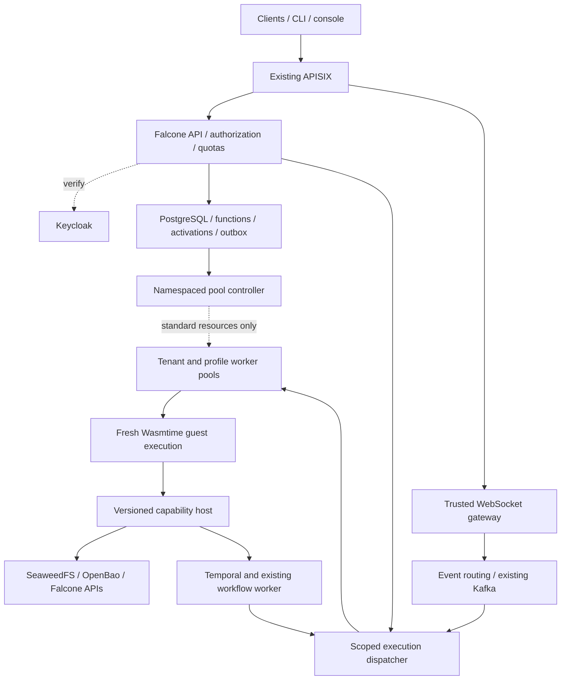

## 3. Baseline architecture — selected Option A

### Components

OpenTelemetry instruments gateways, dispatch, guest lifecycle and host calls. Telemetry and results always carry verified tenant/workspace scope. The diagram does not imply guest access to raw infrastructure credentials.

### Technology and deployment model

| Component | Selected approach | Reason |
| --- | --- | --- |
| Public API | Existing Falcone Node.js services and shared schemas | Preserve existing interfaces, identity, quotas and console |
| Controller | Go service using standard Kubernetes APIs with namespaced RBAC | Reconcile worker Deployments/Services and use namespaced Leases; no custom resource installation |
| Messaging | Existing trusted WebSocket gateway plus Kafka/event routing | Separate connection/message throughput from execution load |
| Dispatch/admission | Falcone service with durable records, reservations and revision pinning | Preserve tenant fairness and accepted-work durability |
| Execution worker | Rust embedding a pinned Wasmtime engine | Direct control of sandbox configuration, imports, budgets and interruption |
| Function artifacts | Validated raw Wasm modules/components plus immutable manifests | No arbitrary tenant OCI image execution |
| Language profiles | Qualified JavaScript adapter first; separately qualify Go and Python | Preserve source semantics where possible without pretending a full Linux environment exists |
| Host interfaces | Versioned WIT/WASI interfaces and narrow Falcone capabilities | Explicit grants for storage, HTTP, events and workflows |
| Storage | Existing PostgreSQL for metadata; SeaweedFS for artifacts/checkpoints/payloads | Reuse established persistence and tenant policies |
| Workflow engine | Existing Temporal/workflow-worker | Durable orchestration, retry coordination and long-job recovery |
| Image delivery | Approved digest-pinned Falcone worker/compiler images in existing registry | Containers package trusted platform code, not arbitrary tenant programs |
| Installation | Namespaced Helm resources under existing corporate admission policy | No operator, CRD, RuntimeClass or elevated SCC prerequisite |

Wasmtime/WASI capability isolation is the selected boundary for untrusted guest code. It requires a correctly secured host interface and patch policy; it is not a claim of zero residual risk. [S26–S27]

### Deployment authority and permission boundary

Use preprovisioned namespaces. Falcone must not require namespace creation, cluster-wide role grants or admission configuration changes. The installer needs explicitly granted namespaced permissions, not merely the ability to create a Deployment.

Preflight must verify required verbs for Deployments, Services, ConfigMaps, scoped Secrets, Jobs if used for trusted compilation, Leases and existing permitted NetworkPolicies. If permissions or network enforcement are absent, report the unmet prerequisite; do not silently disable isolation. Guest worker service accounts have no automatic Kubernetes API token. Controller access is separate and namespaced.

Corporate-owned ingress/TLS, Kafka, storage, database, network policy enforcement and existing SCC remain prerequisites. An application-only design does not create those facilities or grant itself permissions.

PostgreSQL remains authoritative for Function/Revision/Trigger/Job records. API transactions and outbox events drive standard Kubernetes worker-pool resources and route/config generations. No CRDs are required. Users submit declarative manifests through Falcone's API; they do not edit worker resource projections directly.

The native pool scaler is the only writer of replica counts. Desired-state reconciliation must not reset those counts. KEDA/HPA is not a mandatory dependency; any future alternate scaler requires an exclusive ownership handoff.

### Runtime contract and artifact security

A revision records source/artifact digest, language profile, engine/WASI/interface versions, supported imports, resource budgets, granted capabilities and effective configuration. Functions deploy as definitions and artifacts; **10,000 deployed functions do not allocate 10,000 pods or Services**.

Tenant code may be uploaded as raw Wasm or source supported by an approved toolchain. Source conversion uses an approved dependency catalogue. Arbitrary native package install hooks, Dockerfiles, binaries and shell scripts are rejected. A package needing unsupported native libraries must be reported as unsupported rather than built/executed on the host.

Validate uploaded modules before bounded compilation. Accept no tenant-produced native precompiled cache: native engine caches are generated only by trusted platform components and keyed by artifact digest, engine, architecture and configuration. Cache provenance is distinct from the portability of raw Wasm.

Begin with tenant/profile-specific worker pools. Each invocation receives a fresh guest instance and scoped handles. Pool capacity and trusted compiled code can be reused, but dirty guest memory, credentials, temporary files and handles cannot. Use a fresh trusted execution process per invocation for the first qualified implementation where feasible; benchmark the startup cost before enabling more aggressive in-process multiplexing. Process separation supplements the Wasm boundary; it does not replace sandbox validation.

Guest code cannot launch native processes or arbitrary host plugins. The trusted worker may launch the fixed execution harness; that is platform behavior, not a guest capability.

### Host capability model

Provide explicit interfaces for:

- Authorized object read/write and checkpoint access through Falcone storage.
- Allow-listed outbound HTTP with size/deadline limits, redirect and DNS-rebinding checks.
- Event publication with verified tenant/workspace routing.
- Allow-listed workflow start/signal operations through Falcone.
- Structured logging, cancellation state and explicit progress/checkpoint reporting.

Authorization is derived from verified invocation context, never caller-chosen guest fields. Credentials remain in the host binding layer unless a specific reviewed API explicitly grants a narrow secret to guest code. Guest handles are execution-scoped and invalid after completion.

Wasmtime fuel/epoch interruption applies to guest computation, not every blocking host call. Host network/storage operations require their own timeout, cancellation and memory limits; a bounded process termination fallback handles unresponsive executions. [S28]

### Synchronous invocation

1. APISIX/Falcone validates Keycloak identity, resolves tenant/workspace and checks capability/plan.
2. Admission reserves a slot and pins a function revision/profile. Required activation state is persisted.
3. Dispatch selects the authorized tenant/profile pool. If it is at zero, activate it and wait within the bounded request deadline.
4. The trusted execution harness validates the artifact and creates a fresh Wasm instance with only approved imports and grants.
5. Guest code runs; host operations independently enforce scope, budgets and cancellation.
6. Persist outcome, usage and result references; return the existing Falcone envelope for compatible profiles and release reservations.

An HTTP disconnect or timeout does not prove the execution had no external effect. Do not replay uncertain side-effecting calls blindly.

### WebSockets, event delivery and scale

Trusted gateways terminate WebSockets, maintain authentication/reconnect behavior and apply backpressure. Event routing can forward, filter or batch messages without invoking user code when existing semantics permit. Do not silently batch or drop messages if the public contract requires individual delivery.

Persist durable accepted invocations and outbox entries atomically. Kafka dispatch remains at-least-once; dedupe, fenced attempts, retries and DLQ/replay remain explicit. Durable message acceptance and transient WebSocket delivery are different promises and need separate API/benchmark definitions.

Scale connection gateways by connection/message load, dispatchers by backlog, and execution pools by admitted running/waiting work and profile capacity. A basic pool demand estimate is running plus admitted waiting executions divided by per-replica execution capacity, bounded by Falcone quotas and stabilization policy. Validate the control loop under burst/idle/failure tests.

Track incoming messages, outgoing deliveries after fan-out, bytes, triggered invocations and open connections separately. For example, 1% of 100,000 messages triggering one function means 1,000 invocations/second. At a one-second average duration, that needs roughly 1,000 active execution slots; the provisional 400-slot quota would queue or reject excess work. Long jobs further consume capacity, so reserve interactive and analysis budgets.

### Long-running analysis

Expose asynchronous jobs independently of HTTP/WebSocket lifetimes. Require configurable maximum runtime, heartbeat/progress, cancellation, checkpoint retention and explicit restart/resume policy per profile.

Application checkpoints in SeaweedFS contain input digest, revision/profile, checkpoint schema and attempt-fencing identity. A retried worker resumes only from a compatible committed checkpoint. The platform does not promise transparent restoration of arbitrary guest memory.

Temporal coordinates accepted jobs through Activities and one retry owner. On retry, recover the existing accepted execution before launching another attempt. Preserve function revision pins and existing failure classification. Completed Activity history replay is not permission to re-execute external effects. [S3, S22]

Worker scale-down must account for running jobs, checkpoint opportunities and maximum drain periods. Define termination semantics for uncheckpointed jobs honestly: restart may repeat work and side effects.

### Migration and compatibility

Retain public Falcone identifiers, APIs, URLs, schemas, ownership and activation history. Inventory JavaScript dependencies and actual function behavior, not only example request/response JSON. Python threading, process and OS interfaces can differ under Wasm; supported packages must be demonstrated. [S29]

Keep existing Knative only as an optional migration reference where already installed. A clean Option A installation must not install or depend on it. Unsupported old workloads stay explicitly blocked from cutover; they must be adapted or separately resolved before full retirement.

Trusted platform services such as Falcone's own MCP adapter can remain ordinary approved container services. This does not allow tenant-supplied arbitrary MCP server images. Only WebSockets are currently confirmed by the user; preserve any actually deployed MCP contracts found in discovery and leave speculative additional transports out of the initial mandatory scope.

### Proposed measurable objectives

Targets below are provisional engineering objectives, not measured results or contractual SLAs.

| Dimension | Qualification objective |
| --- | --- |
| Inventory | 20 tenants / 10,000 deployed definitions; measure metadata read/deploy latency and controller load independently from worker count |
| Messaging | 100,000 aggregate ingress messages/s under a declared payload, connection, fan-out, durability and trigger-fraction profile; separately report egress and function rates |
| Starting quotas | 20 concurrent executions per tenant, configurable entirely in Falcone; separate analysis and interactive reservations |
| Warm latency | p95 platform overhead ≤20 ms for a preloaded small function under an explicit invocation-rate test; exclude handler duration and report p99 |
| Cold latency | p95 ≤5 s for an agreed small cached-artifact function on available capacity; report Wasm compilation, language interpreter startup, pod start and image pull separately |
| Availability | Initial 99.9% monthly eligible-invocation availability; define dependency failures and quota/overload exclusions before any SLA |
| Single failure | No loss of durably acknowledged asynchronous work within the configured HA/retention envelope; duplicates remain possible |
| Service recovery | Proposed ≤60 s for a single service failure; measure separately from long-job progress recovery and WebSocket reconnection |
| Disaster recovery | Proposed RPO ≤5 min and RTO ≤60 min, conditional on actual backups/replication and a restore exercise |
| Long jobs | Hours-long representative analysis, bounded resource usage and recovery from the last committed application checkpoint; checkpoint interval/loss budget still to agree |
| Sandbox | Adversarial guest/host-boundary tests, independent review and actual restricted-OpenShift evidence before hostile-code production enablement |

The 100,000-message target is not coupled to the warm-invocation latency target until a mixed traffic profile is agreed. No throughput benchmark has been run for this proposal.

